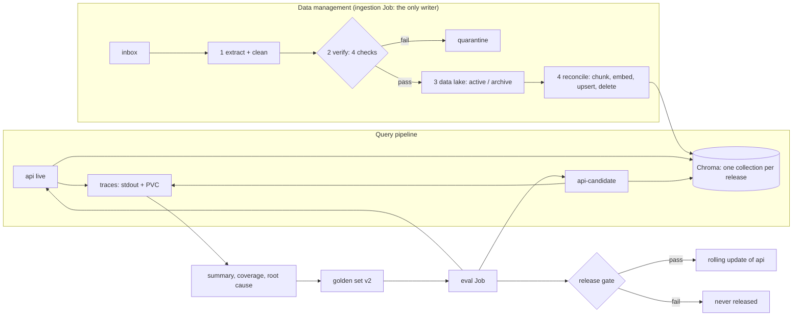

# Target architecture

A design to build against. Nothing here is implemented yet. Changing it is fine; record the change
in `DECISIONS.md` and keep `CONTRACTS.md` in step.

## 1. Two lifecycles on one cluster



## 2. Repository layout (new items marked +)

```
indexer/pipeline/   extract clean chunk embed store          (changed: pages, ids, no drop-all)
  + metadata.py     sidecar and embedded-metadata resolution
  + verify.py       the four checks; pure functions with an injected embed function
  + lake.py         inbox, lake, quarantine, archive, manifest, lock
  + sync.py         reconcile lake to each target collection
  + report.py       verification, ingest and proof reports
  run.py            subcommands: ingest, delete, restore, count, status
api/app/            + trace.py  + guardrails.py  + prompting.py  + routes/retrieve.py
eval/               + run_suite.py (the one command)  + suite/ (metrics, module, component,
                    e2e, judge, noise)  + gate.py compare.py coverage.py trace_tool.py
                    trace_summary.py drift.py  + Dockerfile  + tests/
                    + golden.jsonl module_pairs.jsonl live_queries.jsonl judge_labels.jsonl
                    + batch_b/  + results/{suite,verification,ingest,proofs,gate,compare,
                      stochasticity,coverage,drift,judge_agreement,trace_summary,resources,
                      cluster,release}
+ traces/           committed trace samples
k8s/                base/ (updated)  overlays/  + releases/  + candidate/  + jobs/  + tools/
                    + eval-job.yaml  + gate-thresholds.yaml  + README.md
harness/ .claude/ docs/a3/      this planning layer
```

## 3. Data management

### 3.1 Storage on PVC `rahbar-datalake` (mounted at `/data/lake`)

```
inbox/<batch>/             new or changed files, each with an optional <file>.meta.yaml
lake/<doc_id>/<version>/   original, meta.json, extracted.json (verified copies)
quarantine/<run_id>/       failed file + reason.json
archive/<doc_id>/<version>/ superseded or deleted versions
state/manifest.json        lake state, the source of truth
state/extract-cache/       extracted text by raw sha256 (OCR runs once)
state/ingest.lock          one writer at a time
```

**Source model (D-05).** The lake manifest is the desired state of retrieval. Files arrive through
`inbox/`. A processed file leaves the inbox for the lake or for quarantine. **Deletion is explicit**
(`run.py delete --doc-id`), never inferred from a missing file. Inferring it would be dangerous: a
corrupt update gets moved to quarantine, and "the file disappeared" would then delete the last good
version.

### 3.2 Pipeline order

`extract -> clean -> VERIFY -> update lake -> chunk -> embed -> upsert/delete`

### 3.3 Identity and metadata (D-04)

| Field | Meaning |
|---|---|
| `doc_id` | stable family id across versions, e.g. `ug-academic-rules`. From the sidecar |
| `doc_version` | sortable date or version, e.g. `2023-08`, `2026-06` |
| `raw_sha256` | bytes as delivered |
| `content_sha256` | normalised extracted text |

Resolution order per field: sidecar, then Markdown front matter, then embedded PDF or HTML
metadata, then computed (page count only). Record `metadata_source` per field. **Never invent** a
title, source or date. Write sidecars for corpus A from `corpus/sources.yaml`.

Corpus-specific traps (both from `corpus/sources.yaml`):
- **The two Annual Reports are not versions of each other.** A "same title, newer year" rule would
  archive 2019-20. Give them different `doc_id`s and test for it.
- **The 2026 Prospectus rules and the 2026 Handbook overlap** ("the same rules in 5 pages"). Check
  that the near-duplicate threshold does not quarantine one of them, and report the score.

For a file without a sidecar (the unseen demo batch), a family match may only be *suggested* when
the normalised title matches **and** content overlap is high. Record the evidence in the reason.

### 3.4 Classification of an incoming file (apply in this order)

| Condition | Result |
|---|---|
| unreadable or wrong magic bytes | quality fail |
| same `doc_id`, same `content_sha256` as a lake version | **unchanged**, no-op (not a duplicate) |
| `raw_sha256` or `content_sha256` equals a different document, or an earlier file in this batch | uniqueness fail (exact) |
| same `doc_id`, older version than active | recency fail (stale) |
| same `doc_id`, newer version | accept; archive the old one as superseded |
| same `doc_id`, same version, new content | accept as **changed** |
| different family, near-duplicate by embedding | uniqueness fail (near) |
| otherwise | accept as new |

Two orderings are load-bearing. Without "unchanged" first, a second run would quarantine the whole
corpus as duplicates of itself. Without family resolution before near-duplicate, **every new
version would be rejected as a near-duplicate of its predecessor**.

Process files sorted by `(doc_id, doc_version, filename)`, so two versions in one batch resolve the
same way every time. All four checks are evaluated and recorded for every document even after one
fails; a check that cannot run (no text) records `fail` with that reason. A failed update leaves the
previous version active.

### 3.5 The four checks

| Check | Signals (tune thresholds on corpus A, write them in one config) |
|---|---|
| quality | parser exception; characters per page below a floor; share of replacement or non-printable characters; very low share of word-like tokens; OCR returned nothing |
| completeness | source, title, date or version, page count present; truncation: PDF lacks end-of-file marker or fails strict parsing, declared page count differs, HTML lacks closing tag, declared size or hash differs |
| recency | version comparison inside the `doc_id` family |
| uniqueness | exact by both hashes; near by embedding |

**Near-duplicate method (D-06):** split each document into fixed word windows, embed them with one
fixed `VERIFY_EMBED_MODEL` (independent of the release, so verification verdicts do not change when
a candidate changes the embedding model), and compute the share of windows with a match at or above
cosine `t` in another document. Averaging a 60-page document into one vector hides local
differences. Choose `t` and the share cut-off from **perturbed copies of corpus A** and unrelated
corpus A pairs, then evaluate on Batch B. Tuning on Batch B would be testing on the training data.
Cache window vectors by `content_sha256` so an unchanged run makes no embedding calls.

### 3.6 Reconcile (the incremental update)

For each target collection and each lake version that should be retrievable or retained:

1. `fingerprint = hash(chunker version, cleaner version, size, overlap, embed model, model digest)`
2. `chunk_id = sha256(doc_id | version | section | ordinal | text hash)[:16]`
3. Read existing ids and metadata with `get(where={"doc_id": ...})`.
4. Same expected id set, same `content_sha256` and fingerprint: **skip, embed nothing**.
5. Otherwise embed the missing ids, upsert them, then delete this document's stale ids.
6. Status change only (superseded or restored): `update(metadatas)`, no embedding.
7. Last, sweep ids whose `(doc_id, version)` is not in the manifest and report the orphan count.
8. If anything changed, bump the collection's `index_generation` (used by the cache key).

The vector store describes itself, so there is no second index ledger to drift, and an interrupted
run repairs itself. Chunk metadata: `doc_id, doc_version, content_sha256, fingerprint, source,
section, page_start, page_end, page, superseded, status, chunk_count`.

Superseded versions **stay in the collection** with `superseded=true`, and the existing
`where={"superseded": False}` filter excludes them. `restore` swaps the flags, moves lake folders,
and pins the choice in the manifest so the next CronJob run does not promote the newer one again.
`delete` removes every version from every target collection; prove it with a count by `doc_id`.

### 3.7 Targets and concurrency
The ingestion Job reconciles every collection listed in ConfigMap `rahbar-index-targets` (live,
retained previous release, candidate). A previous collection left stale would make a rollback serve
old data. A test must assert that this list agrees with the release ConfigMaps.

`concurrencyPolicy: Forbid` only stops a CronJob overlapping **itself**. A manual ingestion Job can
still run alongside it, so the Job takes `state/ingest.lock` and exits non-zero if it is held. The
lock needs a stale-owner rule so a killed pod does not block ingestion forever.

## 4. Query pipeline, tracing, rails

- `prompting.py`: one versioned template used by both providers. Retrieved text is delimited and
  declared to be data.
- `trace.py`: build the record as the request proceeds and write it in a `finally` block, so
  abstentions, cache hits and errors are all traced. One line to stdout (`"kind": "trace"`) and to
  `/data/traces/<pod name>.jsonl`. **Per-pod files**: replicas appending to one shared file can
  interleave lines.
- Keep **all** candidates before the relevance floor, with the reason each was dropped. Today an
  abstention returns `retrieved: []` (`answer.py:41-50`), which would leave `D5` nothing to
  diagnose.
- Store the full prompt and its SHA-256. A cache hit stores `cache.source_trace_id`, so `D2` can
  still show the prompt that produced the answer.
- Embedding version = the model digest Ollama reports, not only the tag. Verify the API field
  during implementation.
- Rail (`guardrails.py`): inspect retrieved chunks before prompt construction; drop or redact the
  offending span; record `{rail, action, rule_id, chunk_id, doc_id, excerpt_sha256}`. Also flag the
  user query (input rail, flag only). Test benign policy wording ("students must ignore ...") for
  false positives. A pattern rail is bypassable by paraphrase; say so in the report.
- `POST /api/retrieve` returns ranked candidates without generation, for component tests.
- `POST /api/ask` gains optional `bypass_cache` and `include_trace`; the response gains
  `trace_id`. Additive only; record an ADR because `schemas.py` says the contract is fixed.
  `include_trace` exposes the full prompt, so gate it behind a setting.

## 5. Release bundle (D-07)

A release is everything that changes answers, in one **immutable** ConfigMap:

```
rahbar-release-v1: RELEASE_ID EMBED_MODEL CHROMA_COLLECTION CHUNK_SIZE CHUNK_OVERLAP TOP_K
                   RELEVANCE_FLOOR PROMPT_VERSION LLM_MODEL TEMPERATURE LLM_SEED
```

Remove these keys from `rahbar-config`. The `api` pod template lists `rahbar-config` and exactly one
release map. Releasing changes that reference, which triggers a rolling update; `rollout undo`
restores the old reference, and with it the old collection and embedding model (finding F-10).
Never edit or delete a release map or its collection while it may be rolled back to. With kustomize,
do not let pruning or hash renaming remove old maps. Annotate each release
(`kubernetes.io/change-cause`) so `rollout history` is readable.

`/readyz` already refuses a collection whose embed-model pin differs. With `maxUnavailable: 0`, a
mismatched release stalls while old pods keep serving.

## 6. Kubernetes objects

| Object | Name | RAGOps responsibility |
|---|---|---|
| StatefulSet + PVC | `chroma` | retrieval sources |
| PVC | `rahbar-datalake` | data lake, quarantine, archive (ingestion Job mounts it) |
| PVC | `rahbar-traces` | trace records (API writes, eval and report scripts read) |
| PVC | `rahbar-evaldata` | results and the promoted baseline |
| Job | `ingest-manual` | on-demand ingest and verify; demo batch |
| CronJob | `ingest` (replaces `reindex`) | scheduled re-run, `concurrencyPolicy: Forbid` |
| Job | `rahbar-eval` in `k8s/eval-job.yaml` | offline testing and gate |
| ConfigMap | `rahbar-gate-thresholds` | release criteria, mounted as a file |
| ConfigMap (immutable) | `rahbar-release-vN` | versioned pipeline configuration |
| ConfigMap | `rahbar-index-targets` | collections the writer maintains |
| Deployment + Service | `api` | live query pipeline, `maxUnavailable: 0`, 2 replicas |
| Deployment + Service | `api-candidate` | candidate under test, no user traffic |
| NetworkPolicy | `allow-chroma` and others | only `api`, `api-candidate`, ingestion pods reach Chroma |
| Pod (tool) | `datalake-shell` | `kubectl cp` in and out; read-only except the inbox |

Details that break demos:
- Candidate pods must **not** carry `app: api`, or the live Service sends users to them. Deployment
  selectors are immutable, so use `app: api-candidate` and extend the NetworkPolicies.
- Eval Job: `backoffLimit: 0`, `restartPolicy: Never`. A gate failure must not be retried until it
  passes. Exit 0 pass, 1 gate fail, 2 invalid comparison or infrastructure error (both non-zero fail
  the Job; the log must say which).
- A completed Job cannot be re-run by applying it again: delete it first.
- `kubectl cp` cannot read a **finished** Job's pod. Copy results from `datalake-shell`.
- On Windows, use **relative** local paths with `kubectl cp`: a drive-letter colon is parsed as a
  pod reference.
- All three new PVCs are ReadWriteOnce. That works for several pods only because minikube is a
  single node; say so in the report.
- `readOnlyRootFilesystem: true` stays; give each writer its own writable mount, and check that the
  non-root user can write to the provisioned volume.
- Start minikube with `--cni=calico`, otherwise NetworkPolicies are not enforced.
- Long trace lines: confirm that a line carrying a full prompt comes back from `kubectl logs` as
  one parseable JSON object. Test this early; do not assume it.
- Remove the HPA from the A3 deployment path (D-10).
- A2 CI applies `k8s/overlays/dev` on kind. Keep it working or change it deliberately.

**Single writer (`F2.2`, short answer (f)), stated honestly:** no single Kubernetes object enforces
it. It is layered: only the ingestion image contains write code (checked by a source scan);
`Forbid` plus the lock serialise writers; NetworkPolicy limits who can reach Chroma. NetworkPolicy
cannot tell a read from a write, so a compromised API pod could still write. A read-only proxy that
allows only query, get and count routes would close that gap (optional, D-11).

## 7. Model serving (D-03)
A2 runs Ollama on the host, reached at `host.minikube.internal:11434` (`OLLAMA_HOST=0.0.0.0`). The
assignment requires the pipeline on Kubernetes and lists the API, vector store and Jobs. Confirm
with the instructor that a host-run model server is acceptable. If not, deploy Ollama in the
cluster (the `ollama-incluster` provider name already exists) and budget for CPU-only latency.
