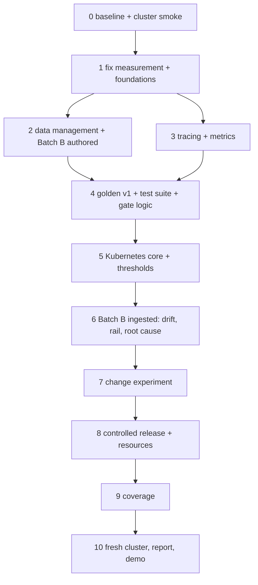

# Implementation plan: Assignment 03, RAGOps layer on RAHBAR

**Late submissions receive zero.** The PDF gives no date: write the deadline in
`harness/state/progress.md` and finish with days to spare.

**Status: plan only. No assignment feature has been implemented.** Commands for code that does not
exist yet are *planned* and have never been run.

Read first: `GAP-ANALYSIS.md` (what is broken today), `ARCHITECTURE.md` (the design),
`CONTRACTS.md` (artifact shapes), `LOOP-ENGINEERING.md` (how to execute), `DECISIONS.md`
(choices the members must confirm). Requirement IDs refer to `REQUIREMENTS.md`.

## 0. How to read this plan
- Each phase has a goal, ordered tasks, an **exit gate** and risks. Do not start a phase whose
  predecessors' exit gates are open.
- Tests first: write the named tests, watch them fail, implement, watch them pass.
- `M1` and `M2` are the two members (`harness/members.toml`). Suggested lanes follow the A2
  branches: M1 data, retrieval and tracing; M2 platform, evaluation gate and release. **Each
  reviews the other's pull requests**, because both must explain everything.
- Size: S, M, L, XL are relative effort, not hours.
- **[HUMAN]** marks work an AI agent must not do or fake.

## 1. Order, and why it matters

Phases 2 and 3 can run in parallel (one per member). **Cluster work starts in phase 0, not
phase 5**: a data or tracing feature is not finished until it has run in a pod.

### 1.1 Evaluation states: the sequence that cannot be redone cheaply

| Step | Corpus | Golden | Live release | Produces |
|---|---|---|---|---|
| S0 | A only | v1 | v1 | two seeded runs (`B.S`), noise (`B.C2`), judge labels (`B.E2`) |
| T | - | - | - | **commit thresholds** (`C2.1`), before any candidate has run |
| S1 | A + B | v1 | v1 | drift report S0 to S1 (`E3`); this run is the gate **baseline** |
| C | A + B | v1 | v1 + candidates | compare (`C1`), gate fail and pass (`C2.3`) |
| R | A + B | v1 | v1 to v2, bad v3, undo | release evidence (`F3.1` to `F3.4`) |
| E | A + B | v1 then v2 | v2 or v1 | coverage before and after (`E2`, `E4.1`); new baseline for golden v2 |

Rules:
1. **Never ingest Batch B before S0 is saved and committed.** Otherwise `E3` has no "before". The
   recovery is a fresh data-lake volume and collection.
2. Golden v1 may include "hard, from Batch B" questions. Mark them `requires_batch: "B"` and report
   the corpus-A subset separately, so S0 against S1 compares like with like.
3. A gate comparison needs the same golden hash and corpus state on both sides (exit 2 otherwise).
4. After `E4.1` changes the golden set, old baselines are not comparable. Take a new one.
5. Thresholds committed at step T are not edited after seeing a candidate's numbers. If one was
   wrong, change it in a separate commit with the reason, re-run everything it touched, and say so
   in the report. Git history shows the order.

---

## Phase 0 - Baseline and cluster smoke test (S)  ·  owner M2, both set up

**Goal:** a green starting line and a cluster that runs A2 on **both** laptops.

| Task | Detail |
|---|---|
| T0.1 | Confirm `DECISIONS.md` D-02, D-03 and D-13 (D-01 is decided). Send the instructor question in D-03 now |
| T0.2 | In the new repo: add the partner as a collaborator; create `dev`; work on `a3/<topic>` branches into it. Point the README badge and clone URL at the new repo. `cd.yml` runs on every push to `main` and its publish job needs Docker Hub secrets that a new repo does not have: add them, or limit the workflow to manual runs (record which) |
| T0.3 | [HUMAN] Each member sets their git identity and fills `harness/members.toml` (`G.4`) |
| T0.4 | Fix the 10 E402 lint errors in `eval/offline_eval.py` so `P.1` passes. Add `harness/tests` to CI |
| T0.5 | Python 3.12 venv; install both `requirements-dev.txt` and `pyyaml`; run the harness tests |
| T0.6 | Preflight: Docker running; free disk (the planning machine had 13 GB free on C:, where Docker and minikube data usually live); `ollama list` |
| T0.7 | `minikube start --driver=docker --cni=calico` with memory and CPUs sized to the laptop; enable `metrics-server` |
| T0.8 | Deploy A2 as it is (`local-real` overlay). Ask one question. Record what breaks on a fresh cluster |
| T0.9 | Spikes, 30 minutes each: (a) does a 30 KB JSON line survive `kubectl logs` intact; (b) can the non-root user write to a new minikube PVC; (c) which Ollama API field gives a model digest; (d) does `chromadb-client==1.0.12` support `get` and `delete` with `where` and a metadata-only `update` |

**Exit gate:** `python harness/verify.py --id P.1` passes; A2 answers on both laptops; spike results
are written in `harness/state/progress.md`. `G.4` passes once both have committed.
**Risk:** disk pressure evicts pods; move Docker's data directory or free space first.

## Phase 1 - Fix measurement and foundations (M)  ·  M1

**Goal:** nothing measured later can be silently wrong. No baseline exists yet, so this is the
only free moment to change the chunker and the cache.

| Task | Files | Requirement |
|---|---|---|
| T1.1 | Keep raw citations next to filtered ones; measure validity on raw | `P.2` |
| T1.2 | Cache key = release id, collection, index generation, prompt version, question. Add bypass. Decide D-09 | `P.3` |
| T1.3 | Page-accurate chunking: track page per paragraph; `page_start`, `page_end`; keep overlap inside a section; bump chunker version | `P.4` |
| T1.4 | `prompting.py`: one versioned template for both providers; move generation settings to config; add `LLM_SEED`; retry with `seed + attempt` so it is deterministic but not identical; make the two relevance-floor defaults one | supports `B.S`, `D1` |
| T1.5 | ADRs: additive API fields (`trace_id`, `bypass_cache`, `include_trace`); chunk id and metadata change | - |

**Exit gate:** `P.2`, `P.3`, `P.4` pass; all A2 tests still pass; CI fixture e2e still works.
**Risk:** the chunker change alters A2 section labels. A2 results are historical from here on.

## Phase 2 - Data management and Batch B (XL)  ·  M1

**Goal:** Part A works against a fake store in tests and a real Chroma on the cluster.

Order of work:

| Step | Tests first | Implementation | Requirement |
|---|---|---|---|
| T2.1 | manifest, lock, resolution order | `metadata.py`, `lake.py`; sidecars for corpus A generated from `sources.yaml`, then **checked by hand** | foundation |
| T2.2 | order test with spies | wire extract, clean, **verify**, lake, chunk | `A1.1` |
| T2.3 | each check, pass and fail | `verify.py`: quality, completeness | `A1.3`, `A1.4` |
| T2.4 | version families, annual-report trap | recency | `A1.5` |
| T2.5 | the four uniqueness tests; calibrate on perturbed corpus A | uniqueness (D-06); write the thresholds and how they were chosen | `A1.6` |
| T2.6 | every document has 4 verdicts with reasons; one report per run | `report.py` (JSON and a readable table) | `A1.2`, `A1.8` |
| T2.7 | quarantined files get zero chunks; a failed update keeps the old version live | quarantine | `A1.7` |
| T2.8 | in-memory fake collection counting embed calls | `sync.py` replaces drop-and-recreate | `A2.1`, `A2.2`, `A2.3` |
| T2.9 | restore re-embeds nothing and survives the next run | supersede, archive, `restore` | `A2.4` |
| T2.10 | CLI: `ingest`, `delete --doc-id`, `restore --doc-id --version`, `count --doc-id`, `status`; each writes its report or proof | `run.py` | all |
| T2.11 | **Author Batch B** and `manifest.json` | `eval/batch_b/` | `AB.1` |

**Batch B design** (at least 10 files; aim for 12 so some are clean):

| Planted | Count | How | Expected catch (confirm from the real report) |
|---|---|---|---|
| exact_duplicate | 2 | one byte copy under a new name; one same text, different container | uniqueness, by raw and text hash respectively |
| near_duplicate | 1 | a corpus A document with small wording edits and a different identity | uniqueness, by embedding |
| truncated_or_corrupt | 1 | a PDF cut mid-file | quality or completeness |
| missing_metadata | 1 | no title, date or version anywhere | completeness |
| newer_version | 1 | new version of an existing `doc_id` with changed, testable facts | accepted; old one archived |
| injection | 1 | a plausible policy page with an embedded instruction | probably **passes all four checks**; the rail must act |
| clean | 3 to 5 | new, legitimate documents (some golden questions use them) | accepted |

[HUMAN] Review every Batch B file. Do not design the verifier around these files: calibrate on
corpus A and run Batch B afterwards. Whatever slips through is the honest answer to short answer
(a), part of `R.4`. Add one hard, realistic case you do not expect to catch (for example a
paraphrased near-duplicate).

**Exit gate:** `python harness/verify.py --part A --stage build` passes. Then a cluster run of
corpus A (needs T5.1 to T5.3; do them here if ready) produces the proofs for `A1.7`, `A2.2`,
`A2.3`, `A2.4`, and the zero-embed pair for `A2.1` (**batch A only**). `AB.2` waits for phase 6.
**Risks:** OCR makes runs slow and non-identical across machines (cache extracted text by raw
hash); the prospectus may score as a near-duplicate of the handbook; HTML pages differ on every
download (change detection uses normalised text, and the corpus is snapshotted once, not
re-fetched by the CronJob).

## Phase 3 - Tracing and metrics (L)  ·  M1

| Task | Detail | Requirement |
|---|---|---|
| T3.1 | `trace.py`: schema 1, written in `finally`; keeps dropped candidates, full prompt and hash, per-stage timings, model digests, collection generation; stdout and per-pod file | `D1` |
| T3.2 | Cache entries store `source_trace_id` | `D1`, `D2` |
| T3.3 | `eval/trace_tool.py <trace_id>`: print context and prompt, recompute and check the hash, follow cache hits, exit non-zero if not found | `D2` |
| T3.4 | Five metric families in `routes/metrics.py` (names fixed by the check) | `D3` |
| T3.5 | `eval/trace_summary.py --since --until`: top-1 distribution, abstention rate, cache hit rate, p95 per stage, injections flagged; define each denominator (are bypass requests in the hit rate?) | `D3` |
| T3.6 | `POST /api/retrieve` | supports `B.C1` |
| T3.7 | Guardrail interface and the no-op trace field now; real rules in phase 6 or earlier | prepares `D4` |

**Exit gate:** `python harness/verify.py --id D1 D2 D3 --stage build`; hand-check one real trace
against the PDF list in `D1`, field by field.
**Risk:** full prompts and user queries in logs are sensitive data (paper 5.1 says record them
securely). Mention retention in the report; never log secrets.

## Phase 4 - Golden set, test suite, gate logic (XL)  ·  M2 runner and e2e, M1 module and component

### 4a. Golden set v1  [mostly HUMAN]
Plan 28 questions for margin: 20 answerable, 8 unanswerable, at least 6 marked hard (overlapping
the others), and at least 10 `human` (`B.G1`).
- [HUMAN] Each member writes at least 5 questions by hand, **from the documents**, with doc id and
  page (`B.G2` needs 8 in total).
- An agent may draft `synthetic` ones with `reviewed_by: null`. [HUMAN] Each member reviews at least
  5 against the PDF page and signs `reviewed_by` themselves (`B.G2` needs 8).
- Take ground truth from the document, never from retrieval output (finding F-07).
- Include version-sensitive, exact-term, multi-chunk, table, scanned-page, injection-adjacent and
  near-miss unanswerable questions (the "CGPA below 1.5" kind that A2 got wrong).
- Freeze v1 (commit and tag) before S0.

### 4b. Suite
| Task | Detail | Requirement |
|---|---|---|
| T4.1 | `suite/metrics.py` with hand-computed tests, including the double-count case | `B.C1` |
| T4.2 | Module: 15+15 pairs (include hard negatives from the same document), means and gap; ms per chunk on real corpus chunks (state batch size and warm-up); embed twice, max absolute difference, also after a model reload | `B.M1`, `B.M2`, `B.M3` |
| T4.3 | Component: ranked pre-floor list from `/api/retrieve` | `B.C1` |
| T4.4 | Noise: **seeded query typos** (D-08). Adding noise documents would require the eval Job to write to the store, breaking `F2.2` | `B.C2` |
| T4.5 | E2E: abstention, raw citation validity, p50 and p95, answer rate | `B.E1` |
| T4.6 | Faithfulness judge: temperature 0, fixed seed, structured verdict, judges the exact context from the trace; unparseable verdict counts as an error, never as supported (D-12) | `B.E1` |
| T4.7 | [HUMAN] Each member labels at least 5 answers **before seeing the judge's verdict**; `judge_agreement` script reports matches out of n | `B.E2` |
| T4.8 | `eval/run_suite.py --target <url> --label <name> --seed 42`: one command, timestamped JSON, summary table on stdout, provenance | `B.R` |
| T4.9 | Run twice, diff per metric, explain (latency jitter, GPU non-determinism, approximate search ties, cold start) | `B.S` |
| T4.10 | `gate.py` with exit codes 0, 1, 2 and the anti-vacuity guards; `compare.py` | `C2.2` |

**Exit gate:** `--part B --stage build` and `--id C2.2 --stage build` pass; a full local or cluster
dry run produces a complete result file. The S0 evidence is taken **on the cluster** after phase 5.
**Risks:** the judge shares the generator's blind spots if it is the same model; runtime may be too
long for the demo slot (measure and record it); answers change between runs, so judge labels are
tied to a trace id and answer hash.

## Phase 5 - Kubernetes core and release thresholds (L)  ·  M2

| Task | Detail | Requirement |
|---|---|---|
| T5.1 | PVCs `rahbar-datalake`, `rahbar-traces`, `rahbar-evaldata`; `datalake-shell` pod; seed script that snapshots corpus A once into the inbox | `F1.2` |
| T5.2 | Remove the fetch init container and `--dummy` from the real path; `ingest` CronJob (`Forbid`) and `k8s/jobs/ingest-job.yaml`; `rahbar-index-targets`; lock test | `F2.1` |
| T5.3 | Tighten `allow-chroma`; add eval-to-api policies; read-only source scan | `F2.2` |
| T5.4 | Release ConfigMap v1 (immutable); remove pipeline keys from `rahbar-config`; API with 2 replicas, `maxUnavailable: 0`; no HPA; keep the dev overlay and CI working | `F1.1` |
| T5.5 | Traces PVC mount, stdout verified with `kubectl logs`, metrics through port-forward | `F4.1`, `F4.2`, `F4.3` |
| T5.6 | `eval/Dockerfile`; `k8s/eval-job.yaml` with `backoffLimit: 0`, results to PVC, git SHA passed in, summary in logs | `F2.3` |
| T5.7 | Restart proof: write, delete pods, list lake, quarantine and archive again; capture | `F1.2` |
| T5.8 | **S0**: seed corpus A, run the ingestion Job twice (zero-embed evidence), run the eval Job twice, copy results out, commit | `A2.1`, `B.S` |
| T5.9 | `k8s/gate-thresholds.yaml` with a justification per rule from S0 data; **commit and push before any candidate run** (step T) | `C2.1` |

Provisional starting points to be replaced by justified values: recall@5 drop at most 0.02 (the
assignment's example); abstention not below baseline; a faithfulness minimum informed by S0 spread
and judge agreement; a p95 ceiling from the S0 p95 plus the observed run-to-run variation.

**Exit gate:** `--part F --stage build` for `F1.1`, `F1.2`, `F2.1`, `F2.2`, `F2.3`, `F4.1`, `F4.2`,
`F4.3`; captures `pvc-survives-restart`, `ingest-job-logs`, `api-logs-trace`,
`metrics-port-forward`, `eval-job-logs` exist. For `eval-job-failed-status`, apply a deliberately
strict threshold, run the Job, capture its `Failed` condition, restore the committed thresholds.
**Risks:** Windows firewall blocks pods from host Ollama; `fsGroup` ignored by the volume
provisioner; a completed Job "unchanged" on re-apply.

## Phase 6 - Batch B: drift, rail, root cause (M)  ·  M1, with M2 for drift

| Task | Detail | Requirement |
|---|---|---|
| T6.1 | Confirm S0 is committed. Copy Batch B to the inbox; run the ingestion Job; report, quarantine proof, counts; run it again for zero embeddings | `AB.2`, `A1.2` |
| T6.2 | Run changed, delete and restore demonstrations on the cluster; keep proofs. Then **return the lake to the intended S1 state** (a deleted or restored demo document must not skew S1) | `A2.2`, `A2.3`, `A2.4` |
| T6.3 | Run the suite: **S1**. `drift.py` lists per-question changes; [HUMAN] state each cause from traces (data, model or software) | `E3` |
| T6.4 | Finish the retrieval rail; ask a question that really retrieves the injected chunk; confirm the action in the trace; run benign-text tests; report whether the answer obeyed the instruction with the rail off and on | `D4` |
| T6.5 | [HUMAN] Pick one wrong or abstained answer. Use **only** `trace_tool.py` output. Write 5 lines: symptom, evidence, faulty chunk, version or filter, cause, fix | `D5` |

If ground truth changed because Batch B superseded a document, **do not edit golden v1 to make the
score recover**. That change is the drift finding. Record it, then decide on new questions in `E4.1`.
**Exit gate:** `--id AB.1 AB.2 D4 E3` (evidence) pass apart from human signatures.

## Phase 7 - Change experiment and gate (M)  ·  M2

**One change** (D-02, recommended: embedding model, `nomic-embed-text` to `mxbai-embed-large`),
because it needs its own collection and makes the rollback visible in a trace. Whether it improves
anything is **unknown** until measured.

| Task | Detail | Requirement |
|---|---|---|
| T7.1 | The relevance floor depends on the embedding model (finding F-11 k). Calibrate it with the same written procedure for both models, on pairs that are **not** golden questions. Because the assignment says **one** change, also run the candidate with the floor **unchanged**, report both, and describe the floor as part of the embedding change, not a second experiment. If the instructor disagrees, switch D-02 to a change that moves one setting only | `C1` |
| T7.2 | Candidate release ConfigMap v2; index its collection with the ingestion Job | `C1` |
| T7.3 | Run the suite on baseline and candidate against the same S1; `compare.py` at all three levels | `C1` |
| T7.4 | Deliberately bad candidate with its own collection (for example very small chunks, no overlap): must fail | `C2.3` |
| T7.5 | Apply the gate to both. Record decision and reasons | `C2.3` |

If the real candidate **fails**, that is a valid result: the release decision is "reject". `C2.3`
still needs a passing candidate, so run a second, separately labelled candidate; never move a
threshold to rescue the first.
**Exit gate:** `C1` and `C2.3` pass.

## Phase 8 - Controlled release, ConfigMap flip, resources (L)  ·  M2

| Task | Detail | Requirement |
|---|---|---|
| T8.1 | `api-candidate` Deployment and Service; eval Job variant targeting it; capture its logs | `F3.1` |
| T8.2 | Rejected candidate: gate fails; show the live pod template and rollout history unchanged; write `rejected.json` from queried values | `F3.3` |
| T8.3 | Trace on v1. Release the passing candidate by changing the release ConfigMap reference; watch `kubectl rollout status`; trace on v2 | `F3.2` |
| T8.4 | Bad release: an operator **bypasses** the gate and releases the bad bundle; show the symptom in metrics or traces; `kubectl rollout undo`; new trace shows the previous collection and embedding version; `undo.json` | `F3.3`, `F3.4`, `C3` |
| T8.5 | Gate flip: same image, edit only the ConfigMap, delete and re-apply the eval Job, outcome changes; record image id and threshold hashes; restore the committed thresholds | `F2.4` |
| T8.6 | Measure under load: sample `kubectl top` for API and Chroma while the suite runs; have Jobs log their own peak memory (short Jobs slip between metrics samples); set requests from typical use and limits from peak plus a stated margin; check Chroma with all retained collections | `F5` |

Use trace requests with `bypass_cache` for `undo.json`. Restart `port-forward` after every rollout,
because it stays bound to one old pod. Do not delete the previous collection or release map.
Note: if only the pass candidate was released first, "previous" in T8.4 means v2. Write the three
stages exactly as they happened.
**Exit gate:** `F2.4`, `F3.1`, `F3.2`, `F3.3`, `F3.4`, `C3`, `F5` (apart from the signature).

## Phase 9 - Coverage (M)  ·  M2

| Task | Detail | Requirement |
|---|---|---|
| T9.1 | At least 40 live queries: about 28 in domain, at least 12 on one to three uncovered topics (for example hostel life or transport, which the corpus excludes on purpose). Include messy user phrasing. [HUMAN] members write or review them and disclose which were generated | `E1` |
| T9.2 | Send them through the API so they also leave traces | `E1` |
| T9.3 | `coverage.py`: nearest golden question per query, share at or above `t`, exit code non-zero when share is below the required share; cluster uncovered queries, then name the topics by hand | `E2`, `E4.2` |
| T9.4 | Justify `t` from the module-level paraphrase and unrelated distributions, **fixed before** looking at the coverage share. Required share: start from the paper's 85 percent and justify | `E2` |
| T9.5 | [HUMAN] At least 6 new golden questions from uncovered topics, **in new words**. Copying a live query makes similarity 1.0 and proves nothing. Report coverage again with near-identical matches removed. Unanswerable topics become unanswerable questions | `E4.1` |
| T9.6 | Re-run coverage and the suite; take a new baseline for golden v2 | `E4.1` |

Keep `eval/golden.jsonl` as the current set and tag v1, so earlier results stay reproducible by
hash. If coverage rises but stays below the required share, the script exits non-zero. Report that.
**Exit gate:** `--part E` passes apart from signatures.

## Phase 10 - Fresh cluster, report, demo (L)  ·  both

| Task | Detail | Requirement |
|---|---|---|
| T10.1 | [HUMAN] Delete the cluster (confirm first), follow `k8s/README.md` literally, fix every gap, capture `fresh-cluster-ready`. Preserve committed results first | `F6` |
| T10.2 | README with `## Part A` to `## Part F`, each with the exact command | `G.6` |
| T10.3 | Commit results, trace samples, manifests; check no secret and no third-party corpus file is staged | `G.3`, `G.5` |
| T10.4 | [HUMAN] Screenshots per `RUNBOOK.md`: command and output, uncropped, labelled, from your own cluster | `S.0`, `S.A`, `S.B`, `S.C`, `S.D`, `S.E`, `S.F` |
| T10.5 | [HUMAN] Report, at most 8 pages plus appendix; names and roll numbers on page 1 | `R.0`, `R.1`, `R.2`, `R.3`, `R.4`, `R.5` |
| T10.6 | [HUMAN] Check the report against the PDF line by line; run the `spec-auditor` agent as a second reader | `G.1` |
| T10.7 | [HUMAN] Viva drills with `/ragops-viva` until each member can explain the other's parts | `G.2` |
| T10.8 | [HUMAN] Two full demo rehearsals **on Kubernetes**, offline if possible, including an unseen batch; both members attend the demo with a laptop running the cluster | `G.7`, `G.8` |

**Final gate:** `python harness/verify.py` exits 0, with every human item signed by a human.

---

## 2. Cross-cutting rules
- **Definition of done for a requirement:** build checks pass, evidence checks pass from a real
  run, the other member reviewed it, and both can explain it.
- **Commits:** small, conventional prefixes, each member under their own identity, pull requests
  reviewed by the other. Never force-push. Commit code before the run whose results you commit.
- **CI:** keep green; add `harness/tests` and `eval/tests`; run `verify.py --stage build` as a
  non-blocking report until phase 10.
- **Secrets and data:** no keys in the repo; `corpus/raw/` stays ignored. The repository is public
  (D-01), so every push is readable by anyone, including other groups. Never commit roll numbers,
  report drafts or the assignment and paper PDFs. `harness/members.toml` is committed: decide what
  to put in it, since `roll_no` and `git_emails` would be public.

## 3. Risk register

| # | Risk | Likelihood | Impact | Mitigation | Phase |
|---|---|---|---|---|---|
| R1 | Cache contaminates candidate evaluation or the undo trace | certain if unfixed | invalid gate and demo | `P.3`, bypass in eval | 1 |
| R2 | `rollout undo` keeps new config | certain with the current ConfigMap | `F3.4` fails | immutable release maps | 5 |
| R3 | Batch B ingested before S0 | medium | `E3` has no baseline | rule 1.1-1; separate seed commands | 5 |
| R4 | New version rejected as near-duplicate; second run rejects the whole corpus | high in a naive design | Part A broken | classification order, tests | 2 |
| R5 | Gate passes a degenerate pipeline | certain with A2 logic | false release | anti-vacuity guards | 4 |
| R6 | Disk or memory pressure on minikube | medium | pods evicted mid-demo | preflight, measured limits, one candidate at a time | 0, 8 |
| R7 | Unseen demo documents all lack metadata and are quarantined | high | looks broken | this is correct behaviour; show reasons, and show adding a sidecar then re-ingesting | 10 |
| R8 | Host Ollama unreachable or not accepted at the demo | medium | demo 0 risk or failure | ask instructor (D-03); preflight script | 0 |
| R9 | No network at the demo | medium | pulls and fetches fail | images, models and corpus snapshot present locally; rehearse offline | 10 |
| R10 | p95 or faithfulness too noisy to gate | medium | flaky decisions | justify limits from run-to-run spread; report n | 4, 5 |
| R11 | One member cannot explain the other's work | medium | demo marks | cross-review, viva drills every phase | all |
| R12 | A number reaches the report without a committed result file | medium | integrity violation | guard hook, provenance, report table cites files | 10 |

## 4. Work only the members can do
Git identities; golden `human` questions and `reviewed_by`; hand labels; Batch B review; live-query
authorship or review; drift causes; the root-cause lines; screenshots; the report and its short
answers; attestations; viva preparation; demo rehearsal; the instructor question. Book time for
these early. They block the loop, and the agent cannot do them for you.
